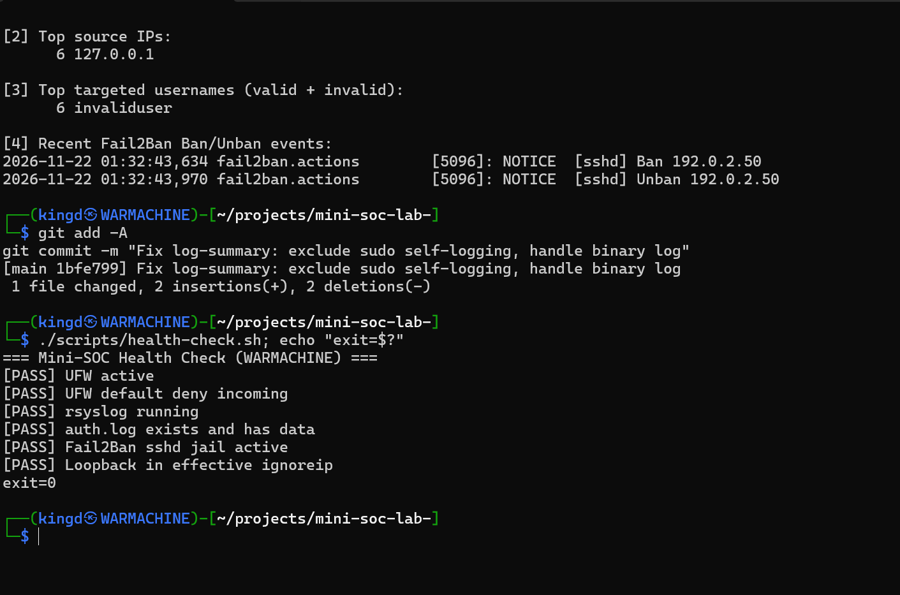
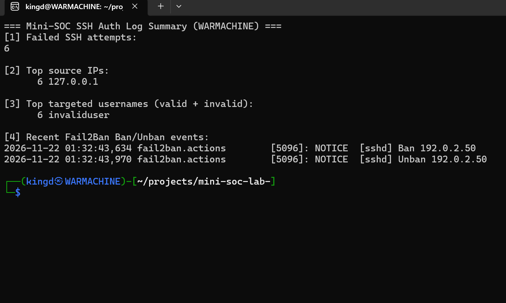

# Mini-SOC / IDS Lab (Kali Linux WSL - WARMACHINE)

A small Blue Team lab built on Kali Linux under WSL to practice host firewalling, authentication log analysis, intrusion prevention validation, and clear security documentation.

> Authorized home-lab use only. All attack simulation targets my own loopback interface.

## What This Lab Demonstrates
- **Host firewalling:** UFW with default deny incoming, SSH allowed.
- **Log ingestion:** rsyslog writing SSH authentication events to `/var/log/auth.log`.
- **Detection and enforcement:** Fail2Ban `sshd` jail (`backend = polling`), filter validated with `fail2ban-regex`, ban/unban verified with `fail2ban-client`.
- **Safe testing:** loopback kept in `ignoreip` by default, temporarily removed only to prove a live ban, then restored.
- **Automation:** scripts that check lab health (PASS/FAIL) and summarize attacks.

## Environment & Architecture
- **Host OS:** Windows 11
- **Linux environment:** Kali Linux WSL (`WARMACHINE`)
- **Target:** Local SSH service (`127.0.0.1`, port 22)
- **Testing scope:** Localhost only (`127.0.0.1`)
- **Firewall:** UFW (default deny incoming, SSH allowed)
- **Log source:** `/var/log/auth.log` (via `rsyslog`)
- **IPS:** Fail2Ban (`sshd` jail, `backend = polling`, monitoring `/var/log/auth.log`)
- **Attack simulation:** Hydra against `127.0.0.1` (lab only)

## Implemented
- **UFW:** Host firewall configured with default incoming deny and SSH allowed.
- **rsyslog:** Log ingestion forwarding authentication events to `/var/log/auth.log`.
- **Fail2Ban:** Intrusion prevention (`sshd` jail, `polling` backend) with filter and ban/unban validation.
- **SSH monitoring:** Monitoring local SSH authentication attempts and simulated brute-force activity (`MITRE ATT&CK T1110`).
- **Bash health checks:** Automated posture checks via `./scripts/health-check.sh` and port checks via `./scripts/recon-check.sh`.
- **Log analysis:** Automated parsing of authentication and Fail2Ban events via `./scripts/log-summary.sh`.

## Future Work
- **Ubuntu Server target:** Separate server host beyond WSL loopback testing.
- **Wazuh SIEM:** Host security monitoring and centralized alert correlation *(not yet deployed in this lab)*.
- **Suricata IDS:** Network intrusion detection and packet-level alert rules *(not yet deployed in this lab)*.
- **Centralized log collection:** Forwarding logs from multiple hosts to a central collector.
- **Dashboard:** Visual SOC/SIEM interface for monitoring alerts and trends.

## Prerequisites

    sudo apt update
    sudo apt install -y ufw fail2ban rsyslog openssh-server hydra nmap shellcheck

## Repository Structure
- `configs/` - reference configuration snapshots (`sshd-wsl.local`, `ufw-policy.md`)
- `docs/` - lab plan, architecture, testing results, limitations, and notes (`lab-plan.md`, `architecture.md`, `testing-results.md`, `limitations.md`)
- `scripts/` - `health-check.sh`, `log-summary.sh`, `recon-check.sh`
- `screenshots/` - evidence from lab runs (`health-check-pass.png`, `log-summary-output.png`, `firewall-status.png`)
- `reports/` - final lab summary (`mini-soc-final-report.md`)

## Running the Scripts

    ./scripts/health-check.sh              # PASS/FAIL checks, exit code 0 = healthy
    ./scripts/log-summary.sh               # failed attempts, top IPs, usernames, Ban/Unban events
    ./scripts/recon-check.sh 127.0.0.1 22  # open ports vs expected policy

## Quick Status Checks

    sudo ufw status verbose
    sudo service rsyslog status
    sudo fail2ban-client status sshd

## Findings & Testing Results
- Hydra generated 6 failed SSH attempts from `127.0.0.1` (`MITRE ATT&CK T1110` - Brute Force).
- Fail2Ban ban/unban verified using documentation test IP `192.0.2.50` while preserving `[DEFAULT]` `ignoreip` safety for loopback.

| Test | Expected Result | Actual Result | Status |
| :--- | :--- | :--- | :--- |
| UFW status | Active | Active | PASS |
| Default incoming | Deny | Deny | PASS |
| rsyslog | Running | Running | PASS |
| SSH jail | Active | Active | PASS |
| Authentication logs | Available | Available | PASS |
| Health check | All checks pass | 6 checks passed | PASS |

## Script Design Notes
- `log-summary.sh` excludes `sudo` self-logging lines so its own commands are not counted as attacks.
- Ban events are read from `/var/log/fail2ban.log`, not `auth.log`.
- `health-check.sh` returns a non-zero exit code on any failed check, so it can be used in automation.

## Limitations
- WSL is not a production server; firewall and ban enforcement may behave differently on bare metal.
- Testing is limited to loopback; no external attacker host yet.
- Detection is log-based (Fail2Ban) only.
