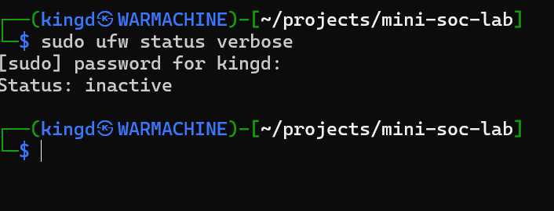

# Mini-SOC / IDS Lab (Kali Linux WSL - WARMACHINE)

A home-lab portfolio built on Kali Linux under WSL (`WARMACHINE`) on a Windows 11 host to practice host firewalling, authentication log analysis, intrusion prevention validation, and accurate security documentation.

> Authorized home-lab use only. All testing targets local loopback (`127.0.0.1`).

## Environment & Architecture
- **Host OS:** Windows 11
- **Linux environment:** Kali Linux WSL (`WARMACHINE`)
- **Target:** Local SSH service (`127.0.0.1`, port `22`)
- **Testing scope:** Localhost only (`127.0.0.1`)
- **Firewall:** UFW (configured for default incoming deny, SSH allowed)
- **Log source:** `/var/log/auth.log` (via `rsyslog`) and `/var/log/fail2ban.log`
- **IPS:** Fail2Ban (`sshd` jail, `backend = polling`, monitoring `/var/log/auth.log`)
- **Attack simulation:** Hydra against `127.0.0.1` (lab only)

## Implemented
- **UFW:** Host firewall setup and policy verification (`ufw status verbose`).
- **rsyslog:** Authentication log collection into `/var/log/auth.log`.
- **Fail2Ban:** `sshd` jail (`polling` backend) configuration and `Ban`/`Unban` verification via test IP `192.0.2.50`.
- **SSH monitoring:** Analysis of failed SSH login attempts and targeted usernames (`MITRE ATT&CK T1110` simulation against `127.0.0.1`).
- **Bash checks & recon:** Posture checks via `./scripts/health-check.sh` and normalized port policy checks via `./scripts/recon-check.sh`.
- **Log analysis:** Deduplicated failed SSH attempt counting, IPv4/IPv6 source extraction without timestamp false-positives, and Fail2Ban event summaries via `./scripts/log-summary.sh`.

## Future Work
- **Ubuntu Server target:** Dedicated Linux server host and separate attacker host beyond WSL loopback.
- **Wazuh SIEM:** Host security monitoring and centralized alert correlation *(not yet deployed in this lab)*.
- **Suricata IDS:** Network intrusion detection and packet-level alert rules *(not yet deployed in this lab)*.
- **Centralized log collection:** Forwarding logs across multiple hosts to a central collector.
- **Dashboard:** Visual SOC/SIEM interface for alert monitoring and trends.

## Prerequisites

    sudo apt update
    sudo apt install -y ufw fail2ban rsyslog openssh-server hydra nmap shellcheck

## Repository Structure
- `configs/` - reference configuration snapshots (`sshd-wsl.local`, `ufw-policy.md`)
- `docs/` - lab plan, architecture, testing results, and limitations (`lab-plan.md`, `architecture.md`, `testing-results.md`, `limitations.md`)
- `scripts/` - `health-check.sh`, `log-summary.sh`, `recon-check.sh`
- `screenshots/` - captured terminal outputs (`health-check-pass.png`, `log-summary-output.png`, `firewall-status.png`)
- `reports/` - lab summary report (`mini-soc-final-report.md`)

## Running the Scripts

    ./scripts/health-check.sh              # PASS/FAIL posture checks (exit 0 = healthy)
    ./scripts/log-summary.sh               # failed SSH attempts, top IPs/users, Ban/Unban events
    ./scripts/recon-check.sh 127.0.0.1 22  # normalized open ports vs expected policy

## Quick Status Checks

    sudo ufw status verbose
    sudo service rsyslog status
    sudo fail2ban-client status sshd

## Findings & Testing Results
- Hydra testing against `127.0.0.1` generated failed SSH attempts (`MITRE ATT&CK T1110` - Brute Force) recorded in `/var/log/auth.log`.
- Fail2Ban `Ban`/`Unban` behavior was verified on `192.0.2.50` in `/var/log/fail2ban.log`; an automatic live ban triggered directly by Hydra is not claimed as verified evidence.
- Screenshot evidence reflects the exact system state at capture time (for example, `screenshots/firewall-status.png` shows `Status: inactive` when captured prior to enabling UFW).

| Test | Expected Result | Actual Result | Status |
| :--- | :--- | :--- | :--- |
| UFW status | Active (when enabled) | `inactive` in current capture; `Active` when enabled | CONDITIONAL / CAPTURE-DEPENDENT |
| Default incoming | Deny (when UFW active) | `Deny` when UFW active | PASS (when active) |
| rsyslog | Running (when started) | `Running` when service started | PASS (when running) |
| SSH jail | Active (when Fail2Ban started) | `Active` when service started | PASS (when running) |
| Authentication logs | Available | `/var/log/auth.log` present and readable | PASS |
| Log summary & IPv6 safety | Accurate counts, no HH:MM:SS false IPs | Deduplicated attempt counts, IPv4/IPv6 extracted cleanly | PASS |

## Script Design Notes
- `log-summary.sh` excludes `sudo` lines, deduplicates multi-line SSH auth failure entries for the same session/timestamp, and extracts source IPs after `from ` to avoid matching `HH:MM:SS` timestamps.
- Ban/Unban events are read from `/var/log/fail2ban.log` (`grep -aE`), not `/var/log/auth.log`.
- `health-check.sh` returns a non-zero exit code when any check fails.

## Limitations
- WSL is not a bare-metal Linux or production server; service state and firewall behavior depend on WSL session state.
- Testing is restricted to loopback (`127.0.0.1`); no external attacker host or multi-host environment is present yet.
- Current detection is host log-based (Fail2Ban) only.
